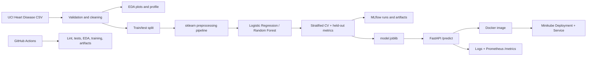

# Heart Disease UCI — End-to-End MLOps Assignment

**Scope:** educational binary classification demo, experiment tracking, reproducible packaging, CI, Docker API, Minikube deployment, logging, and Prometheus metrics.

> **Medical disclaimer:** This repository is for coursework and software engineering demonstration only. The UCI Cleveland dataset is small, historical, and not representative of all patient populations. The output is not a diagnosis, a validated clinical risk score, or a substitute for professional medical care. Do not use it for real patient decisions.

## Architecture



## Repository map

- `src/data.py`: downloads and validates the canonical processed Cleveland dataset; binarizes target values 0 vs 1–4.
- `src/eda.py`: histograms/class balance, correlation heatmap, JSON profile.
- `src/preprocessing.py`: train-fitted median imputation/scaling and most-frequent imputation/one-hot encoding.
- `src/train.py`: stratified train/test split, 5-fold CV, grid search, MLflow logging, metrics/plots, serialized full pipeline.
- `src/api.py`: FastAPI `/predict`, `/health`, `/metrics`, request and prediction logs.
- `tests/`: data, preprocessing/model, API tests.
- `.github/workflows/ci-cd.yml`: lint, tests, dataset acquisition, EDA, training and workflow artifacts.
- `deployment/`: Kubernetes Deployment and NodePort Service.

## Requirements

- Python 3.11 recommended
- Git
- Docker Desktop or Docker Engine
- For Kubernetes: Minikube and `kubectl`
- Network access for initial dataset download and dependency installation

## Run locally

```bash
python -m venv .venv
# macOS/Linux:
source .venv/bin/activate
# Windows PowerShell:
# .venv\Scripts\Activate.ps1

python -m pip install --upgrade pip
pip install -r requirements.txt
python -m src.data
python -m src.eda
python -m src.train
pytest -q
ruff check src tests
```

Outputs are written under `artifacts/` and MLflow's local tracking store under `mlruns/`. Start the MLflow UI in another terminal:

```bash
mlflow ui --backend-store-uri ./mlruns --host 127.0.0.1 --port 5000
```

Open `http://127.0.0.1:5000`. The trainer compares Logistic Regression and Random Forest with ROC-AUC grid search and logs parameters, cross-validation score, held-out metrics, plots, a classification report, and a model artifact. The selected model is chosen by mean stratified 5-fold CV ROC-AUC; held-out test metrics are reported separately.

## API usage

Training must finish first so `artifacts/model.joblib` exists.

```bash
uvicorn src.api:app --host 127.0.0.1 --port 8000
```

- Interactive schema: `http://127.0.0.1:8000/docs`
- Health: `http://127.0.0.1:8000/health`
- Prometheus metrics: `http://127.0.0.1:8000/metrics`

Sample request:

```bash
curl -X POST http://127.0.0.1:8000/predict \
  -H 'Content-Type: application/json' \
  -d '{
    "age": 58, "sex": 1, "cp": 4, "trestbps": 130, "chol": 250,
    "fbs": 0, "restecg": 0, "thalach": 140, "exang": 0,
    "oldpeak": 2.0, "slope": 2, "ca": 0, "thal": 3
  }'
```

Response includes binary prediction, label, model confidence and probability of the positive class. Values are illustrative; do not interpret the output clinically.

## Docker

Build only after running training, because the image includes the model artifact:

```bash
python -m src.data
python -m src.train
docker build -t heart-disease-mlops:local .
docker run --rm -p 8000:8000 heart-disease-mlops:local
```

Test in another terminal:

```bash
curl http://localhost:8000/health
curl http://localhost:8000/metrics
```

Or use `docker compose up --build`. To run Prometheus with the API:

```bash
docker compose -f docker-compose.monitoring.yml up --build
```

Prometheus UI: `http://localhost:9090`. Query `api_requests_total` or `api_request_latency_seconds`. The provided Prometheus config expects service name `api` on the Compose network.

## Minikube

Use a local cluster and load the built image into it:

```bash
minikube start
python -m src.data
python -m src.train
docker build -t heart-disease-mlops:local .
minikube image load heart-disease-mlops:local
kubectl apply -f deployment/deployment.yaml
kubectl rollout status deployment/heart-disease-api
kubectl get pods,svc
kubectl port-forward service/heart-disease-api 8000:8000
```

Then use `http://localhost:8000/docs` and `http://localhost:8000/health`. The included Service is NodePort (`30080`) for a simple local demonstration; port-forwarding is often the easiest cross-platform access path. For `minikube service heart-disease-api --url`, use the URL printed by Minikube. If image or startup changes, rebuild and reload the image.

## CI/CD

GitHub Actions runs on pushes, pull requests and manual dispatch. It checks Ruff, runs Pytest, downloads data, generates EDA, trains models, and uploads `artifacts/` and `mlruns/` as a workflow artifact. This is CI plus a training pipeline; it does **not** automatically publish an image to a registry or deploy a public service. Add registry credentials and deployment approvals only if extending it to cloud.

## Reproducibility notes

- Fixed split and CV seeds (`42`).
- Stratified 80/20 held-out split.
- Preprocessing is inside a single scikit-learn Pipeline, preventing train/test preprocessing leakage.
- Median imputation and standard scaling for numeric features; most-frequent imputation and one-hot encoding for categorical-coded features.
- MLflow logs hyperparameters, CV ROC-AUC, held-out accuracy/precision/recall/F1/ROC-AUC, classification report, plots and model.
- Exact package ranges are in `requirements.txt`. For strict bit-for-bit reproduction, also pin transitive dependencies and record Python/OS details.

## Dataset and limitations

Dataset: UCI Machine Learning Repository, Heart Disease (Cleveland processed data). Original feature definitions and dataset documentation: https://archive.ics.uci.edu/dataset/45/heart+disease . The classic processed Cleveland subset has 303 observations and 13 predictors; missing values are represented with `?`. The target is binarized to 0 = no disease and 1 = any positive value (original values 1–4). The script tries UCI first and a public mirror if UCI is unavailable. Inspect the data source and licensing/terms for your submission requirements.

## Evidence checklist

Capture real outputs/screenshots in `screenshots/`:
1. EDA distributions and correlation heatmap
2. MLflow experiment runs and metrics
3. Pytest passing output
4. GitHub Actions successful run and uploaded artifacts
5. Docker container running and `/docs` prediction request
6. Prometheus scrape status and a metric query
7. Minikube pod/service and successful health check
8. A short screen recording of data → training → tests → container → deployment

## Troubleshooting

- `Model not available`: run `python -m src.data && python -m src.train`.
- Dataset download errors: check network access; the script falls back to a mirror.
- `ImagePullBackOff`: load the local image into Minikube with `minikube image load heart-disease-mlops:local` and keep `imagePullPolicy: IfNotPresent`.
- Port already in use: change the left side of `-p`, e.g. `8001:8000`.
- MLflow UI shows no runs: check the current working directory and use `mlflow ui --backend-store-uri ./mlruns`.

## Submission checklist

- [ ] Push repository to GitHub and add repository URL to the report.
- [ ] Run all tests and save actual output.
- [ ] Run EDA and training; review generated metrics, not assumed values.
- [ ] Build and test the Docker image.
- [ ] Deploy to Minikube and capture screenshots.
- [ ] Complete placeholders in `report/` with genuine evidence.
- [ ] Record the pipeline walkthrough video and link it in the report.
