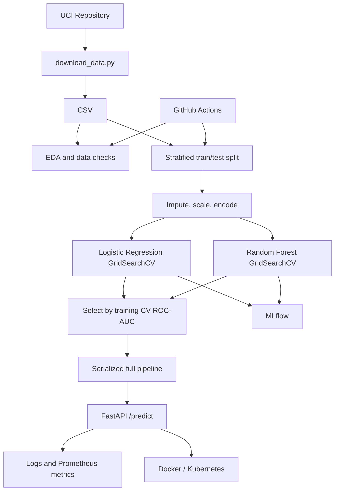

# Architecture

The API returns a binary prediction, confidence, class probabilities, and an educational-use disclaimer. `/health` checks service availability and model load state; `/metrics` exposes Prometheus metrics.
